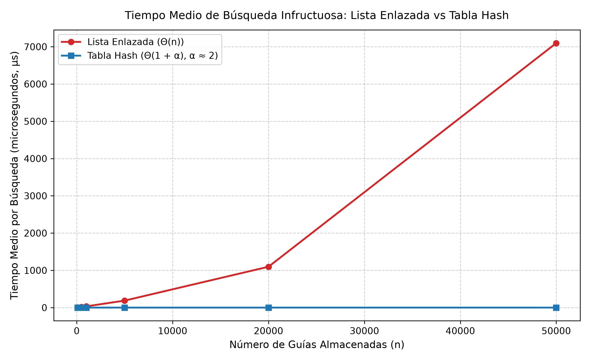
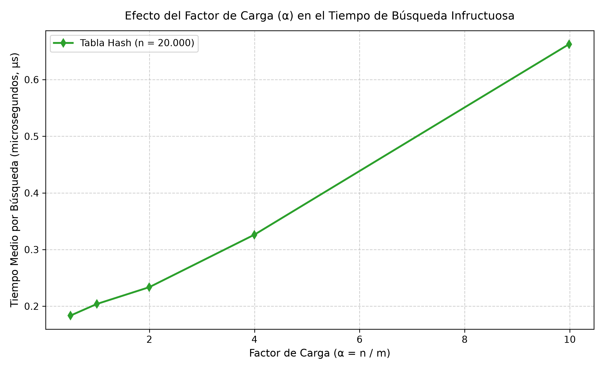

# Laboratorio evaluativo 03 — Estructuras de datos

**Estudiante:** Johan Sneider Garzon Salazar  
**Curso:** Análisis de Algoritmos  
**Fecha:** Octubre 2026  

---

## Instrucciones de reproducción

Para reproducir las pruebas unitarias y los experimentos de medición con sus respectivas gráficas, siga estos pasos desde la raíz del repositorio:

1. **Activar el entorno virtual:**
   - En Windows (PowerShell):
     ```powershell
     .\venv\Scripts\Activate.ps1
     ```
   - En Linux/macOS (Bash):
     ```bash
     source venv/bin/activate
     ```

2. **Ingresar a la carpeta del laboratorio:**
   ```bash
   cd laboratorios/lab3-estructuras-datos
   ```

3. **Ejecutar las pruebas unitarias:**
   ```bash
   python pruebas.py
   ```

4. **Ejecutar la medición experimental y regenerar las gráficas:**
   ```bash
   python medicion.py
   ```

Las figuras se generarán automáticamente en la carpeta `graficas/` ([graficas/lista_vs_tabla.png](graficas/lista_vs_tabla.png) y [graficas/tiempo_vs_alfa.png](graficas/tiempo_vs_alfa.png)).

---

## Parte 1 — Implementación y verificación

- Código fuente de las estructuras: [estructuras.py](estructuras.py)
- Pruebas automatizadas con asertos: [pruebas.py](pruebas.py)

En [estructuras.py](estructuras.py) se implementaron desde cero las estructuras requeridas sin recurrir a tipos nativos como `dict`, `set` ni a la función intrínseca `hash()`:
1. `Nodo`: Almacena la guía entera (`guia`), el estado del envío (`estado`) y el puntero al siguiente nodo (`siguiente`).
2. `ListaEnlazada`: Implementa una lista simplemente enlazada con inserción en la cabeza en $\Theta(1)$ y búsqueda iterativa mediante ciclo `while` para prevenir errores de recursión profunda (`RecursionError`).
3. `TablaHash`: Implementa una tabla hash con encadenamiento reutilizando `ListaEnlazada` para cada una de sus $m$ casillas. Aplica la función hash por el método de la división ($h(k) = k \pmod m$) y calcula dinámicamente el factor de carga $\alpha = n / m$.

En [pruebas.py](pruebas.py) se verificó la corrección lógica mediante asertos (`assert`), cubriendo:
- Búsquedas exitosas de guías existentes y búsquedas infructuosas (guías inexistentes que retornan `None`).
- **Colisión forzada:** Con $m = 7$, las guías `10`, `24` y `17` producen residuo 3 ($10 \equiv 24 \equiv 17 \pmod 7$). Se validó que las tres se insertan y consultan exitosamente, que la lista de la casilla 3 tiene longitud 3 y que `factor_carga()` da exactamente $3 / 7$.
- **Colecciones aleatorias:** 25 escenarios aleatorios con distintos tamaños y casillas donde la lista enlazada y la tabla hash devuelven resultados idénticos ante guías existentes e inexistentes.

---

## Parte 2 — Medición y gráficas

- Script de medición experimental: [medicion.py](medicion.py)

Para evaluar el rendimiento real frente a la teoría, en [medicion.py](medicion.py) se ejecutaron dos experimentos independientes. Se utilizó `time.perf_counter()` cronometrando únicamente las búsquedas (aislando la construcción y el llenado) con semillas fijas para reproducibilidad (`semilla=77` y `semilla=99`). Para filtrar el ruido del planificador del sistema operativo, cada medición se promedió sobre 5 repeticiones independientes de 200 consultas inexistentes:

- **Experimento A (Lista frente a Tabla):** Se evaluaron seis tamaños $n \in \{100, 500, 1000, 5000, 20000, 50000\}$ con valores de $m$ primos cercanos a $n / 2$ ($m \in \{53, 251, 503, 2503, 10007, 25013\}$), fijando un factor de carga $\alpha \approx 2$.
- **Experimento B (Efecto del factor de carga $\alpha$):** Con $n = 20.000$ fijo, se varió $m \in \{40009, 20011, 10007, 5003, 2003\}$ obteniendo factores $\alpha \in \{0.50, 1.00, 2.00, 4.00, 9.99\}$.

### Tabla 1 — Tiempos medidos: Lista vs Tabla ($\alpha \approx 2$)

| $n$ | $m$ (primo) | $\alpha = n / m$ | Tiempo Lista ($\mu\text{s}$) | Tiempo Tabla ($\mu\text{s}$) |
|---:|:---:|:---:|:---:|:---:|
| 100 | 53 | 1.89 | 3.22 | 0.19 |
| 500 | 251 | 1.99 | 17.10 | 0.38 |
| 1000 | 503 | 1.99 | 34.10 | 0.64 |
| 5000 | 2503 | 2.00 | 187.92 | 0.61 |
| 20000 | 10007 | 2.00 | 1096.57 | 0.61 |
| 50000 | 25013 | 2.00 | 7096.66 | 0.91 |



### Tabla 2 — Tiempos medidos: Efecto del factor de carga ($n = 20.000$)

| $m$ (casillas) | Factor de carga $\alpha$ | Tiempo medio de búsqueda ($\mu\text{s}$) |
|---:|:---:|:---:|
| 40009 | 0.50 | 0.18 |
| 20011 | 1.00 | 0.20 |
| 10007 | 2.00 | 0.23 |
| 5003 | 4.00 | 0.33 |
| 2003 | 9.99 | 0.66 |



---

## Parte 3 — Análisis

### 1. Costo teórico

En una lista enlazada desordenada, si una guía no existe, no puede anticiparse su ausencia. Se recorre secuencialmente desde la cabeza hasta `None`, examinando los $n$ elementos. Así, toda búsqueda infructuosa realiza $n$ comparaciones, con costo determinista $\Theta(n)$.

En una tabla hash con encadenamiento, la función hash calcula el índice en tiempo $\Theta(1)$ y solo se recorre la lista de esa casilla. Esto se sostiene bajo la hipótesis de **dispersión uniforme simple**, cuya condición formal exige que cada clave tenga probabilidad $P(h(k) = j) = 1/m$ de caer en cualquier casilla $j$, de forma independiente. La longitud esperada de cada lista es su esperanza $E[n_j] = \alpha = n / m$. Al buscar una clave inexistente, se evalúan en promedio $\alpha$ nodos más el cálculo del hash, arrojando un costo medio de $\Theta(1 + \alpha)$. Si esta hipótesis se vulnera y todas las claves colisionan en una sola casilla, la tabla degenera en una lista gigante de tamaño $n$, degradando el peor caso a $\Theta(n)$.

### 2. Lo medido contra lo esperado

En la gráfica `lista_vs_tabla.png`, la diferencia es notoria. Comparando dos valores consecutivos como $n = 500$ y $n = 1000$:
- En la **lista enlazada**, el tiempo medio pasó de $17.10\ \mu\text{s}$ a $34.10\ \mu\text{s}$ ($1.99\times$). Al duplicar datos, el tiempo se duplicó prácticamente de forma exacta, coincidiendo con el orden lineal $\Theta(n)$. Para $n = 50.000$, la lista alcanzó $7.096\ \mu\text{s}$ (~$7.1\text{ ms}$).
- En la **tabla hash**, el tiempo se mantuvo en el rango de submicrosegundo ($0.19\ \mu\text{s}$ a $0.91\ \mu\text{s}$). La curva se mantiene plana en $\Theta(1)$ porque fijamos $m$ primo con $\alpha \approx 2$ constante.

En la gráfica `tiempo_vs_alfa.png`, con $n = 20.000$ y variando $\alpha$:
- Con $\alpha = 0.50$, el tiempo fue $0.18\ \mu\text{s}$.
- Con $\alpha = 2.00$, subió a $0.23\ \mu\text{s}$.
- Con $\alpha = 4.00$, subió a $0.33\ \mu\text{s}$.
- Con $\alpha = 9.99$, llegó a $0.66\ \mu\text{s}$.

A mayor $\alpha$ (listas más largas por casilla), el tiempo de búsqueda infructuosa sube linealmente, confirmando la relación $\Theta(1 + \alpha)$.

### 3. Manejo de colisiones

Una colisión ocurre cuando dos claves distintas producen la misma casilla: $h(k_1) = h(k_2)$. Aunque haya más casillas que datos ($m > n$), ocurren porque comprimimos enteros de diez dígitos en un rango acotado $[0, m - 1]$. Por el principio del palomar y la paradoja del cumpleaños, basta un grupo moderado para que coincidan.

Se resuelven de dos formas:
1. **Encadenamiento:** Cada casilla contiene una lista enlazada. Si colisiona, el nuevo nodo se inserta al inicio. Ventaja: no se llena y admite $\alpha > 1$. Costo: memoria en punteros y menor localidad de caché.
2. **Direccionamiento abierto:** Los elementos van en el arreglo. Si la casilla está ocupada, se busca otra libre mediante sondeos. Ventaja: memoria contigua y mejor uso de caché. Costo: requiere $\alpha < 1$ y sufre de agrupamiento.

Con $m = 7$, las guías $10$, $24$ y $17$ dan residuo $3$ ($10 \equiv 24 \equiv 17 \pmod 7$). Las tres colisionan en la casilla 3. Con encadenamiento, esa casilla guarda una lista con los 3 nodos, recuperándolos sin pérdida de datos.

### 4. Tabla hash frente a árbol de búsqueda binario

Para el monitoreo por rango (*"guías entre X y Y"*), **la tabla hash no sirve**. Su función dispersa las claves pseudoaleatoriamente para evitar colisiones y destruye el orden. Hallar el rango exige revisar las $m$ casillas e inspeccionar los $n$ elementos en $\Theta(n + m)$.

Un **Árbol de Búsqueda Binario (BST)** sí es apto porque preserva el orden ($izq < raíz < der$). Permite buscar el límite inferior y recorrer en orden podando ramas en $\Theta(\log n + k)$, donde $k$ son los elementos del rango.

Si las 400.000 guías llegaran ordenadas a un BST común, cada nodo se agregaría como hijo derecho. El árbol degeneraría en una lista con altura $h = 400.000$, costando unas 400.000 comparaciones en el peor caso ($\Theta(n)$). En cambio, un árbol balanceado (AVL o Rojo-Negro) mantendría altura $h \approx \lceil \log_2(400.000) \rceil \approx 19$, resolviendo la búsqueda en apenas ~19 comparaciones.

### 5. Concepto técnico para la jefa de operaciones

**Recomendación:**  
Sugiero una **arquitectura híbrida**:
1. Una **Tabla Hash** con $\alpha \approx 1$ ($m \approx 400.000$) para el **call center**, asegurando consultas puntuales inmediatas en $\Theta(1)$.
2. Un **Árbol Balanceado** (B-Tree o Rojo-Negro) sobre el número de guía para que **operaciones** filtre rangos eficientemente.

**Estimación para 5.000.000 de envíos:**  
*Nota:* Esta estimación proviene de una sola medición empírica en $n = 50.000$ (Intel Core i7, Python 3.11 en Windows) y puede variar entre equipos por velocidad de RAM y jerarquía de caché.
- **Lista Enlazada:** Con $n = 50.000$, la búsqueda infructuosa tardó $7.10\text{ ms}$. Al crecer linealmente $\Theta(n)$, con 5 millones de guías (100 veces más) tardará mínimo:
  $$7.10\text{ ms} \times 100 \approx 710\text{ ms} \approx 0.7\text{ segundos}$$
  Por fallos de caché L3 al saltar por 5 millones de punteros en RAM, el tiempo real superará de 1 a 2 segundos por consulta fallida.
- **Tabla Hash:** Dimensionada con $m \approx 2.500.000$ ($\alpha \approx 2$), mantendrá la cota $\Theta(1 + \alpha)$. El tiempo estimado será de **$1$ a $2$ microsegundos** ($0.000002\text{ s}$), siendo cientos de miles de veces más rápida.
